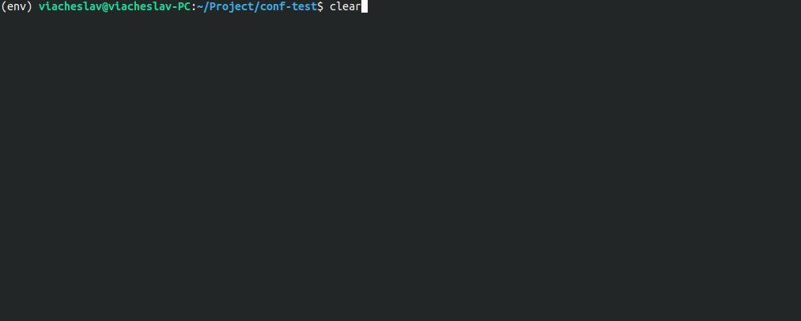

# Confpoint (Confluence / SharePoint) tools

This module contains a set of CLI utils for working with the Atlassian Confluence and the Microsoft SharePoint.
It contains three submodules: *publisher, uploader, downloader*.



----------------------------------------------------------------

* **publisher** module allowed to you a public and remove Confluence page. The page creating from markdown file.

Using example (*PowerShell script*):

```PowerShell
py -m confpoint.publisher --user "user@mail.com" --apikey "123abc" `
                          --space "your space" `
                          --parent "parent page (optional)" `
                          --title "title page in Confluence" `
                          --file "*.MD file which will be published" `
                          --link "https://your_domain.atlassian.net"
```

----------------------------------------------------------------

### Mermaid diagrams

The publisher automatically renders fenced `mermaid` blocks as PNG attachments.
The original Markdown is never modified; intermediate files are removed after
publication. Documents without Mermaid do not require any additional tools.

Install Node.js and Mermaid CLI locally before publishing diagrams:

```sh
npm install -g @mermaid-js/mermaid-cli
confpoint-publisher --file docs/overview.md --user "$JIRA_EMAIL" \
  --apikey "$JIRA_TOKEN" --space KKT --title "Overview" --link "$JIRA_SITE"
```

Optional publisher arguments:

* `--mermaid-cli mmdc`: CLI command (a quoted command with arguments is supported).
* `--mermaid-format png|svg`: attachment format; PNG is the default.
* `--mermaid-timeout 120`: positive per-diagram timeout in seconds.
* `--mermaid-no-sandbox`: disable Chromium sandbox **only for trusted diagrams**
  on systems where the sandbox cannot run. The default keeps sandbox enabled.

Rendering errors stop publication before the page is changed. Upload failures
can still leave a partially published page: page updates and attachment uploads
are not atomic. Re-publishing the same document updates stable attachment names;
obsolete attachments are not deleted automatically. Keep document basenames
unique when publishing multiple source documents into the same page.
No external rendering service is used and no tools are downloaded automatically.

----------------------------------------------------------------

* **uploader** module allowed to you upload a file or directory to the SharePoint server.

Using example (*PowerShell script*):

```PowerShell
py -m confpoint.uploader --user "user@mail.com" --password "pass" `
                         --file "path/to/uploading/file" `
                         --remote "remote/path/in/SharePoint/server" `
                         --group "your sharepoint group (somthing like /sites/Team)" `
                         --link "https://your_domain.sharepoint.com" `
                         --timeout 10
```

----------------------------------------------------------------

* **downloader** module allowed to you download a file or directory from the SharePoint server. Also support recursive downloading content from directory.

Using example (*PowerShell script*):

```PowerShell
py -m confpoint.downloader --user "user@mail.com" --password "pass" `
                           --outputdir "path/to/local/output/directory" `
                           --remote "remote/path/in/SharePoint/server" `
                           --group "your sharepoint group (somthing like /sites/Team)" `
                           --link "https://your_domain.sharepoint.com" `
                           --recursive
```

## Usefully notes

* For building .exe file:

  ```terminal
  ./py2exe.ps1
  ```

* Create virtual env and activate it

  ```terminal
  py -m venv env
  .\env\Scripts\activate
  ```

* Install from [TestPyPi](https://test.pypi.org/):

  ```terminal
  pip install --index-url https://test.pypi.org/simple/ --extra-index-url https://pypi.org/simple confpoint
  ```

## Usefully notes and links

* Install dependency: pip3 install -r requerments.txt
* Get token for confluence.[Check this arcticle](https://docs.searchunify.com/Content/Content-Sources/Atlassian-Jira-Confluence-Authentication-Create-API-Token.htm) [or this](https://confluence.atlassian.com/enterprise/using-personal-access-tokens-1026032365.html)
* For upload files to SharePoint use your login and password (login == --user; password == --apikey)
* Open file pusher.cmd and write your login, token and etc
* Docker imgage with [Confpoint and PowerShell](https://github.com/Mcublog/confpoint-docker)
